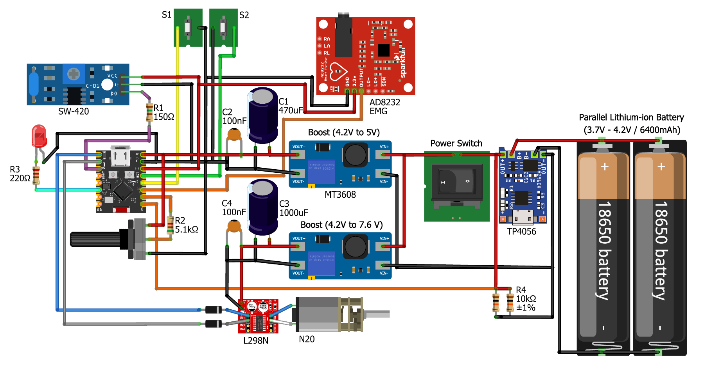

# Wired_Claw_Orthesis

An electromyography (EMG) controlled claw orthosis prototype that integrates signal acquisition and motor control on a single ESP32-C3 board. An AD8232 supplies the analog signal, and an H-bridge drives an N20 DC motor to open or close the claw.

This version uses wired connections and does not require Bluetooth.

## Repository contents

```text
Wired_Claw_Orthesis/
├── firmware/
│   └── Garra_EMG_Local/
│       └── Garra_EMG_Local.cpp
├── hardware/
│   └── Circuito_com_AD8232_2-2.pdf
├── docs/
│   └── images/
│       └── circuito.png
├── .gitignore
├── THIRD_PARTY_NOTICES.md
└── README.md
```

- [Arduino firmware source](firmware/Garra_EMG_Local/Garra_EMG_Local.cpp)
- [Circuit diagram (PDF)](hardware/Circuito_com_AD8232_2-2.pdf)

## Hardware

- ESP32-C3 Mini.
- AD8232 module and electrodes for muscle signal acquisition.
- N20 DC motor and H-bridge.
- Potentiometer for threshold adjustment.
- Two limit switches: opening and closing.
- Vibration/tilt input and status LED.
- Power supply and battery monitoring as shown in the supplied circuit diagram.



The PDF documents the assembly supplied by the author. Including the drawing does not constitute electrical validation of every connection or module identification. The table below documents the pins required by the firmware.

## GPIO assignments

| GPIO | Code identifier | Function |
|---|---|---|
| 0 | `PIN_BAT` | Analog battery reading |
| 1 | `potPin` | Threshold potentiometer |
| 2 | `PIN_EMG` | AD8232 analog output |
| 3 | `Screw_nut_` | Opening limit switch; HIGH indicates stop |
| 4 | `Push_Claw_` | Closing limit switch; LOW indicates stop |
| 5 | `H1` | Closing PWM output |
| 6 | `H2` | Opening PWM output |
| 7 | `pinoSensor` | Vibration/tilt input |
| 10 | `LED_PIN` | Local battery status LED |

Both limit switches use `INPUT_PULLUP`, but their stop conditions have different polarities. The wiring must reproduce these conditions rather than assume that both switches stop the motor at LOW.

## Signal acquisition and processing

The ADC is configured for 12-bit resolution. Each muscle activity calculation uses 400 samples:

1. Read the AD8232 output on GPIO2.
2. Apply a low-pass filter configured at 40 Hz, `OD3`.
3. Apply a high-pass filter configured at 10 Hz, with `OD3` requested.
4. Rectify the filtered signal using its absolute value.
5. Average the 400 samples with a software gain of 1.0.

```text
MES = sum of absolute filtered values / 400
MES1 = MES × 0.99
MES2 = MES × 0.96
MES3 = MES × 0.93
MES4 = MES × 0.90
MESth = potentiometer reading × 0.00244 + 5
```

The threshold ranges from approximately 5 to 14.99. Contraction requires all five values to be greater than or equal to the threshold; relaxation requires all five to be less than or equal to it. These values are derived from the same MES and are not independent measurements. An intermediate range can exist in which neither condition is true.

### Timing in this version

The firmware retains `Ts = 0.01`. Each sample includes a 500 µs delay in addition to ADC and processing time, so the actual sampling period differs from the period configured in the filters. The 10 Hz and 40 Hz values are configured parameters, not measured physical cutoff frequencies.

The `readMES(400)` function is blocking and takes more than 200 ms. Limit switches and states are evaluated after acquisition. The PWM ramp has a configured interval of 60 ms, but its updates depend on loop execution time.

The libFilter high-pass implementation supports up to second order; requesting `OD3` uses its second-order implementation. See the [library source](https://github.com/MartinBloedorn/libFilter/blob/master/filters.cpp) for details.

## State machine

After an initial two-second delay with zero PWM, the system executes `CALIBRATING` to close the claw until it reaches the closing limit switch. EMG acquisition continues during calibration but does not determine movement in this state.

| State | Action | Transitions, in priority order |
|---|---|---|
| `CALIBRATING` | Close using H1 | Closing limit LOW: set PWM to zero and enter `IDLE` |
| `IDLE` | Motor off | Contraction and opening limit LOW: `OPEN`; otherwise, relaxation and closing limit HIGH: `CLOSE` |
| `CLOSE` | Close using H1 | Closing limit LOW: set PWM to zero and enter `HOLD`; otherwise, contraction: `OPEN` |
| `HOLD` | Motor off | Contraction: `OPEN`; otherwise, relaxation and closing limit HIGH: `CLOSE` |
| `OPEN` | Open using H2 | Opening limit HIGH: set PWM to zero and enter `IDLE`; otherwise, relaxation: `CLOSE` |

PWM levels are `25 → 76 → 153 → 230`, approximately 10%, 30%, 60%, and 90% of the 8-bit scale. `HOLD` means the motor is off; this state does not implement active force control.

## Battery and LED

The local battery reading uses an average of 50 ADC samples:

```text
Vbat = (average_ADC / 4095) × 3.3 × 2
Battery (%) = constrain((Vbat − 3.6) / 0.6 × 100, 0, 100)
```

The factor of 2 assumes the corresponding voltage divider. The percentage is a linear voltage estimate without load compensation or individual ADC calibration.

The LED provides battery indications only in `IDLE` and `HOLD`:

| Battery percentage | LED behavior |
|---|---|
| Above 30% | Configured alternation: 200 ms on / 200 ms off |
| Above 20% and up to 30% | Off |
| Up to 20% | On |

The LED stays off in all other states. Blocking acquisition also limits LED updates. Battery level does not inhibit motor movement in the current code.

The tilt input updates `vibracaoDetectada`, but this variable does not participate in motor control in this version.

## Dependencies and setup

- Arduino IDE with Espressif ESP32 board support.
- [libFilter by Martin Bloedorn](https://github.com/MartinBloedorn/libFilter), which provides `filters.h`.

libFilter is an external dependency; its source code is not included in this repository. Follow the author's installation instructions: place the `libFilter` folder in the Arduino sketchbook libraries directory, including `filters.h`, `filters.cpp`, and `filters_defs.h`.

1. Install ESP32 support using the Arduino IDE Boards Manager.
2. Install libFilter and restart the IDE if necessary.
3. The repository stores the firmware as `firmware/Garra_EMG_Local/Garra_EMG_Local.cpp`. To use it as a standalone Arduino IDE sketch, create a sketch named `Garra_EMG_Local` and copy the source into its `Garra_EMG_Local.ino` file. Avoid compiling duplicate copies of the source.
4. Select the board matching your ESP32-C3 Mini and its USB port.
5. Check the wiring, limit switch polarities, and battery voltage divider.
6. Compile and upload the firmware.

Serial Plotter diagnostics are commented out at the end of the source. Uncomment that block to enable them and use 115200 baud.
